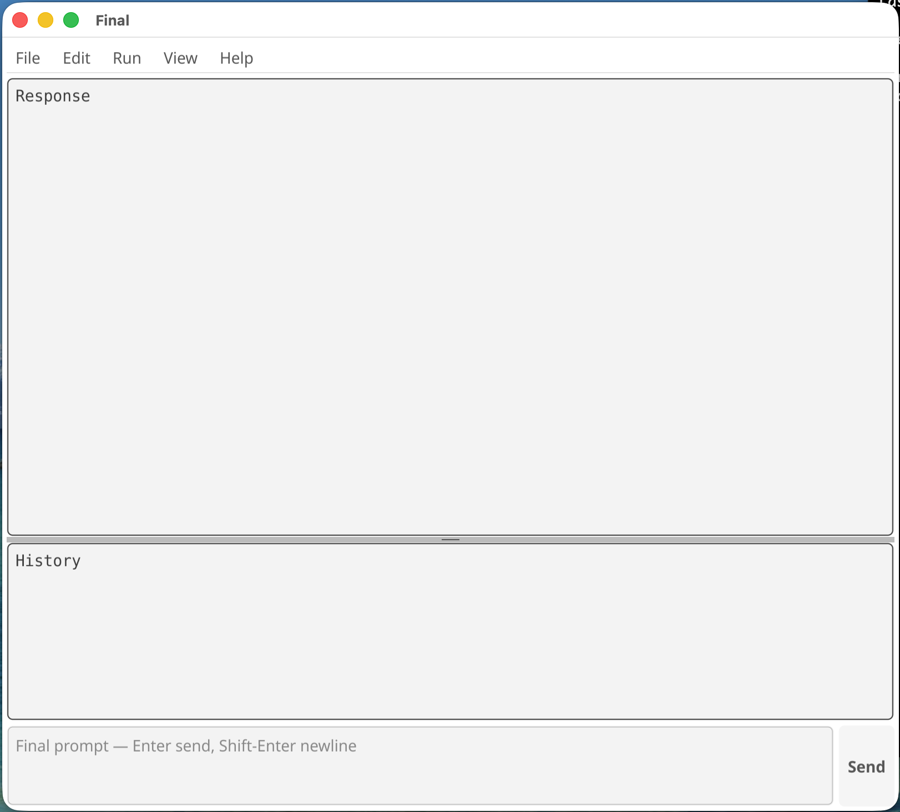

# The Final GUI version

When you launch `final-gui` from the command line or your GUI you should see the following Graphical User Interface TUI (with empty text boxes.) You can resize the Window. (Note: for ssh, use the `final` binary; it will work, with some limitations, over ssh.)

## 

Let's take a quick look at the GUI, starting from the bottom:

**Prompt Area**
This is where you enter Final commands, or code. `Enter` sends the current text in the area. You can use Shift-Enter to add new lines without sending. And if you Paste text from an editor, with newlines, it won't send until you hit `Enter` or press `Send`.

**History Area**
This shows a running list of the prompts you sent. You can copy code from this text area.

**Response Area**
This shows the result of a Send. If the result contained no text, "(ok)" is printed, as confirmation. Just like History, you can copy text from this text area.

**Menu Bar**
This contains three particularly useful commands:

File/Load -- let's you browse for a .fnl file, which is loaded (compiled); 
View -- Prompt/History (Response and History) or Stdout/Stderr (standing `$` / `$$`); the current view’s menu item is disabled;
Help/Words -- this will get you started with Final's built-in help.

## Example conventions used in this guide

Code examples in this guide do not try to depict the GUI--this would be both wasteful of screen space, and impossible to copy from. Instead, we use a pseudo bare command line interface that looks like this:

```forth
> 1 2 + $

3
```

* the text after > and any non-empty lines below are the prompt
* a blank line
* the expected output of the prompt, which may be many lines; or (ok) if no output is expected

Working along with the examples, you can either type into the GUI Prompt area, or copy/paste.

On to some code!
