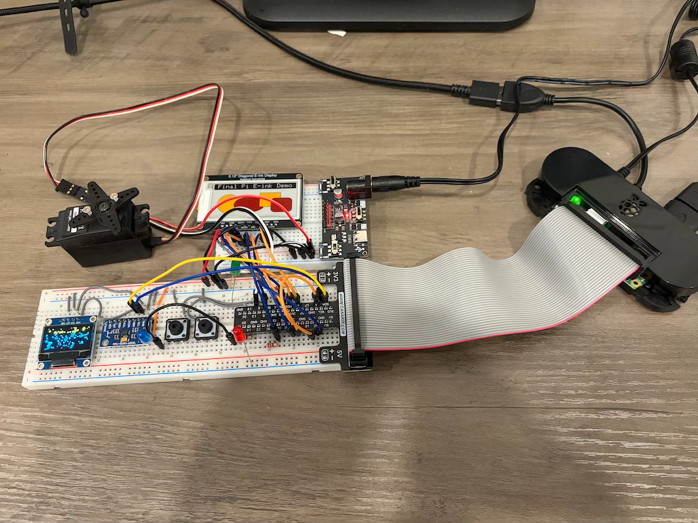

# Introduction

  

Welcome to IoT/Maker/Hardware control of Raspberry Pi using Final! This guide assumes you have already installed and are familiar with Final. See the [Final User Guide](../intro/SUMMARY.md) for installation and how to run and use Final. Note: you must use the Raspberry Pi installation of Final, not the Linux version. Only the Pi version has the hardware and software support for Pi.

**Supported boards:** Raspberry Pi 5 and Raspberry Pi Zero 2W. Pi OS 32 and the 32-bit version of Final is sugggested for Pi Zero 2W. (However, the 64-bit version of Pi OS and Final have been tested on Pi Zero 2W.)

Final has modest runtime and disk requirements. It should run fine on a 4 GB RAM Pi 5; Zero 2 is happier on Lite without a desktop. On Pi 5, ou can use either the `final` TUI binary, or `final-gui` GUI binary for hardware control. `final-gui` is not supported on 32 bit OSs. Note that only the `final` runtime supports command line launching of Final programs, so even if you develop on GUI, you will need to use `final` if you intend to run your controller headless, or from systemd.

## Installation

Follow the [Final Installation Instructions](../intro/first/installation.md) to install Final on your Pi. Use the Raspberry Pi build, not the generic Linux build — only the Pi build includes hardware support.